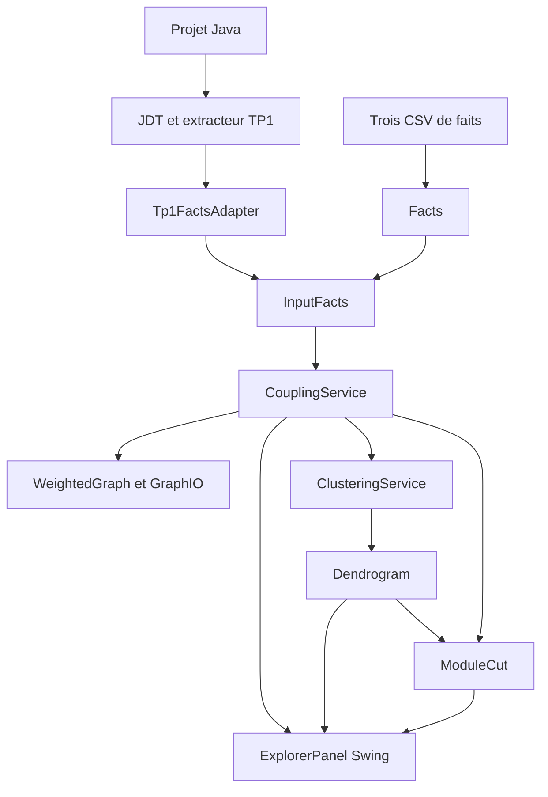

# Architecture

La chaîne principale utilise `hai913i.tp1` comme producteur des faits puis `hai913i.tp2` pour les calculs. Le détail des conventions et leur interprétation figurent dans le rapport.

| Package TP2 | Responsabilité |
|---|---|
| `input` | Frontière d'entrée, adaptation TP1 et relations structurelles facultatives |
| `coupling` | Comptage des relations et couplage normalisé |
| `graph` | Graphe non orienté, classement, isolées, exports et rechargement |
| `clustering` | Lien moyen/simple, dendrogramme et coupe |
| `gui` | Exploration interactive du même modèle Swing |

`Main` orchestre les étapes et les exports. Le chemin TP1 analyse les sources une fois avant d'entrer dans la chaîne TP2 ; les calculs ne reparcourent pas les AST. Le chemin CSV ne lit pas de code source.

Les tests sous `source/src/test` utilisent les fixtures Java de `source/resources`, les faits canoniques de `resources/` et le micro jeu de `resources/mini/`. Ces répertoires doivent être conservés ensemble dans le dépôt.
